# Tender Management System - Database ER Diagram

`SMC_TENDER_DATABASE.sql` is the authoritative definition for all database objects. This diagram
shows the principal business relationships; it is not a substitute for the complete DDL.

```mermaid
erDiagram
    Roles ||--o{ Users : "has"
    Departments ||--o{ Users : "belongs to"
    Departments ||--o{ Tender : "owns"
    Users ||--o{ Tender : "creates"
    Tender ||--o{ Estimate : "has"
    Tender ||--o{ ApprovalHistory : "tracks"
    Tender ||--o{ TenderDocuments : "has"
    Tender ||--o{ BOQ : "has"
    Tender ||--o{ TechnicalBid : "receives"
    Tender ||--o{ FinancialBid : "receives"
    Tender ||--o{ Agreement : "results in"
    Tender ||--o{ WorkOrder : "results in"
    Tender ||--o{ WorkExecution : "tracked by"
    Tender ||--o{ MeasurementBook : "recorded in"
    Tender ||--o{ Bills : "billed via"
    Contractors ||--o{ TechnicalBid : "submits"
    Contractors ||--o{ FinancialBid : "submits"
    Contractors ||--o{ Agreement : "signs"
    Contractors ||--o{ WorkOrder : "awarded"
    Contractors ||--o{ Bills : "submits"
    Users ||--o{ Contractors : "login account"
    Bills ||--o{ Payments : "paid via"
    Users ||--o{ ApprovalHistory : "acts on"
    Users ||--o{ AuditLog : "performs"
    Roles ||--o{ WorkflowStages : "approves at"
    Roles ||--o{ RolePermissions : "granted"
    Permissions ||--o{ RolePermissions : "mapped"
    Tender ||--o{ TenderWorkflowAssignments : "assigned stages"
    Tender ||--o{ TenderWorkflowHistory : "stage history"
    Tender ||--o{ TenderVerificationReviews : "document reviews"
    Tender ||--o{ TenderShortfalls : "shortfalls"
    TenderShortfalls ||--o{ TenderShortfallItems : "contains"
    TenderShortfallItems ||--o{ TenderShortfallSubmissions : "submission history"
    Tender ||--o{ TenderFinancialApprovals : "financial decisions"
    Tender ||--o{ TenderGeneratedDocuments : "versioned outputs"
    Tender ||--o{ TenderPublicationSchedule : "publication history"
    Tender ||--o{ TenderExtensionRequests : "extension requests"
    Tender ||--o{ TenderLifecycleHistory : "lifecycle audit"
    Tender ||--o{ TenderBudgetOpinions : "budget opinions"
    Tender ||--o{ TenderRequiredBidDocuments : "required bidder documents"
    Tender ||--o{ TenderDocumentVerificationHistory : "verification history"
    Tender ||--o{ TenderFinancialBidOpening : "financial opening"
    TenderFinancialBidOpening ||--o{ TenderFinancialBidOpeningDetails : "opened bids"
    FinancialBid ||--o{ TenderFinancialBidDocuments : "financial documents"
    Tender ||--o{ TenderNotifications : "notifications"
    TenderTypes ||--o{ Tender : "category"
    Users ||--o{ AuditLog : "performs"
    Users ||--o{ TenderWorkflowAssignments : "assigned officer"

    Roles {
        int RoleId PK
        string RoleName
    }
    Departments {
        int DepartmentId PK
        string DepartmentName
    }
    Users {
        int UserId PK
        string FullName
        string Email
        string PasswordHash
        int RoleId FK
        int DepartmentId FK
    }
    Tender {
        int TenderId PK
        string TenderNumber
        string Title
        int DepartmentId FK
        decimal EstimatedAmount
        string CurrentStatus
        int CreatedBy FK
    }
    Estimate {
        int EstimateId PK
        int TenderId FK
        decimal Amount
        int PreparedBy FK
    }
    ApprovalHistory {
        int ApprovalId PK
        int TenderId FK
        string ApprovalStage
        string PreviousStatus
        string NewStatus
        int ApprovedBy FK
    }
    TenderDocuments {
        int DocumentId PK
        int TenderId FK
        string DocumentType
        string FilePath
    }
    BOQ {
        int BOQId PK
        int TenderId FK
        string ItemName
        decimal Quantity
        decimal Rate
    }
    Contractors {
        int ContractorId PK
        string Name
        string RegistrationNo
        int UserId FK
    }
    TechnicalBid {
        int TechnicalBidId PK
        int TenderId FK
        int ContractorId FK
        string Status
    }
    FinancialBid {
        int FinancialBidId PK
        int TenderId FK
        int ContractorId FK
        decimal BidAmount
        int Rank
    }
    Agreement {
        int AgreementId PK
        int TenderId FK
        int ContractorId FK
        string AgreementNo
    }
    WorkOrder {
        int WorkOrderId PK
        int TenderId FK
        int ContractorId FK
        string OrderNo
    }
    WorkExecution {
        int ExecutionId PK
        int TenderId FK
        decimal ProgressPercentage
    }
    MeasurementBook {
        int MBId PK
        int TenderId FK
        decimal Quantity
    }
    Bills {
        int BillId PK
        int TenderId FK
        int ContractorId FK
        decimal Amount
        string Status
    }
    Payments {
        int PaymentId PK
        int BillId FK
        decimal Amount
        string TransactionNo
    }
    AuditLog {
        bigint LogId PK
        int UserId FK
        string Action
        string EntityName
    }
    WorkflowStages {
        int StageId PK
        string StageName
        int ApproverRoleId FK
    }
    Permissions {
        int PermissionId PK
        string PermissionName
    }
    RolePermissions {
        int RoleId PK, FK
        int PermissionId PK, FK
    }
    TenderTypes {
        string TypeName PK
        int SortOrder
        bit IsActive
    }
    TenderMethods {
        string MethodName PK
        int SortOrder
        bit IsActive
    }
    TenderWorkflowHistory {
        bigint HistoryId PK
        int TenderId FK
        string PreviousStatus
        string NewStatus
        int UserId FK
    }
    TenderSchemaMigrations {
        string MigrationId PK
        string Description
        datetime AppliedAtUtc
    }
```

## Notes
- DepartmentModule changes `Tender.CurrentStatus` and inserts the matching `ApprovalHistory` row with parameterized ADO.NET statements in one transaction. It does not invoke a stored procedure.
- DepartmentModule applies the role/status transition rules in its Web Forms code-behind. The existing `WorkflowStages` table remains part of the shared schema and is reused by the legacy application; this module does not edit its contents.
- `BOQ.Amount` is a computed, persisted column (`Quantity * Rate`).
- Soft delete is used on `Tender` (`IsDeleted`) so the full workflow trail is never lost.
- `Tender.TenderType` retains the historical procurement-method value; `Tender.TenderCategory`
  references the separate category catalog in `TenderTypes`. New method values are maintained in
  `TenderMethods`.
- Verification, shortfall submissions, financial approvals, generated-document versions, and
  workflow histories remain separate records so their responsible stages and audit evidence are
  not collapsed into a single row.
- No legacy business tables were merged or renamed. New setup objects are `Designations`,
  `TenderMethods`, and `TenderSchemaMigrations`.
