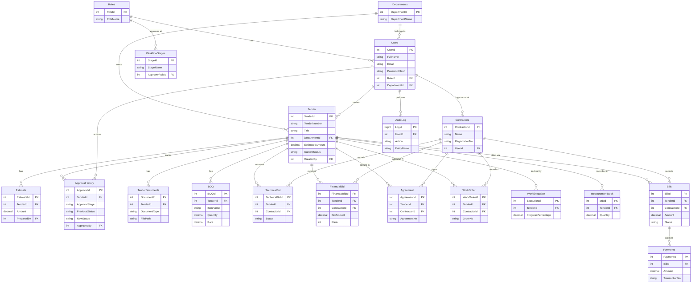

# Tender Management System – Database ER Diagram

## Notes
- DepartmentModule changes `Tender.CurrentStatus` and inserts the matching `ApprovalHistory` row with parameterized ADO.NET statements in one transaction. It does not invoke a stored procedure.
- DepartmentModule applies the role/status transition rules in its Web Forms code-behind. The existing `WorkflowStages` table remains part of the shared schema and is reused by the legacy application; this module does not edit its contents.
- `BOQ.Amount` is a computed, persisted column (`Quantity * Rate`).
- Soft delete is used on `Tender` (`IsDeleted`) so the full workflow trail is never lost.
